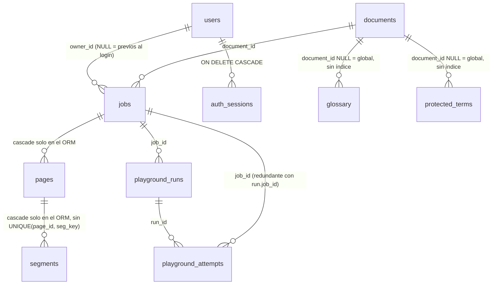

# Revisión del backend (noviembre 2026)

Revisión de `backend/` (FastAPI + SQLAlchemy + Alembic sobre SQLite, worker aparte) sin cambios de código, con la
guía `fastapi-db-review`. Cada problema tiene su ficha (`NN-slug.md`: qué pasa, cómo reproducirlo, impacto y
corrección propuesta) y su archivo de aceptación (`NN-slug.aceptacion.md`: casillas con resultados verificables).
Las casillas empiezan vacías (`- [ ]`) y se marcan (`- [x]`) con una línea «Verificado:» al comprobarlas.

No hay hallazgos críticos: autorización por propietario (IDOR), CSRF/Origin, inyección SQL, secretos y asignación
masiva se revisaron y están bien.

## Línea base (16 de noviembre de 2026)

- Versiones: FastAPI 0.163.1, Starlette 1.10, Pydantic 2.14.3, SQLAlchemy 2.1.9, Alembic 1.20.1, pytest 9.2.
- Modo síncrono (`get_db` con `yield`, `expire_on_commit=False`); el worker (`app/worker.py`) se coordina con la API
  por las tablas `jobs` y `playground_runs`. SQLite (WAL, `foreign_keys=ON`) en producción y en los tests.
- `cd backend && .venv/bin/python -m pytest -q -m "not slow and not s3"`: **138 passed, 1 skipped, 5 deselected** (34 s).
- ruff, mypy/pyright y `alembic check`: no instalados / no se ejecutan (#15).
- Migraciones: 10, lineales; cabeza `d2e4f6a8c0b1` = la de `data/app.db`.
- Datos (solo lectura): 1 libro, 192 páginas, 3345 bloques, 149 entradas de glosario, 2141 de caché, 4 usuarios,
  114 sesiones (113 revocadas). `PRAGMA foreign_key_check` vacío; sin duplicados en glosario, `(page_id, seg_key)`
  ni `sha256`.
- Queries por petición sobre una copia de la BD real (incluyen 3 de la sesión de auth):

| Endpoint | Queries |
|---|---|
| `GET /api/jobs` (1 trabajo) | 5 (+2 por trabajo) |
| `GET /api/jobs/1` | 5 (una trae las 192 páginas) |
| `GET /api/admin/jobs/1/summary` | **198** |
| `GET /api/admin/jobs/1/pages/10/segments` | 5 |
| `GET /api/jobs/1/pages` | 4 |
| `GET /api/admin/playground/books` | 5 |
| `GET /api/glossary?document_id=1` | 3 |

## Mapa de relaciones

`auth_security_events.user_id` no es FK a propósito (la bitácora sobrevive a la cuenta). `files`, `prompt_drafts`
y `translation_cache` no tienen relaciones. Diferencias modelo/esquema: el CHECK `ck_users_role` solo está en la BD
(#17); ninguna FK salvo `auth_sessions` tiene `ON DELETE` (#09).

## Problemas

| # | Severidad | Problema | Aceptación | Estado |
|---|---|---|---|---|
| 01 | Alto | [Una corrección manual se pierde si se guarda mientras el libro se procesa](01-edicion-perdida-durante-proceso.md) | [criterios](01-edicion-perdida-durante-proceso.aceptacion.md) | resuelto |
| 02 | Alto | [El worker puede sobrescribir una cancelación con «done», «paused» o «failed»](02-worker-pisa-cancelacion.md) | [criterios](02-worker-pisa-cancelacion.aceptacion.md) | resuelto |
| 03 | Medio | [Pedir otra recomposición mientras se recompone pierde la petición](03-recomposicion-pierde-paginas.md) | [criterios](03-recomposicion-pierde-paginas.aceptacion.md) | resuelto |
| 04 | Alto | [El estado de un trabajo carga todas sus páginas y el listado hace N+1](04-job-status-carga-paginas.md) | [criterios](04-job-status-carga-paginas.aceptacion.md) | resuelto |
| 05 | Alto | [El resumen del admin hace una consulta por página](05-summary-n-mas-1.md) | [criterios](05-summary-n-mas-1.aceptacion.md) | resuelto |
| 06 | Alto | [Las subidas directas bloquean el event loop](06-async-bloqueante-subidas.md) | [criterios](06-async-bloqueante-subidas.aceptacion.md) | resuelto |
| 07 | Bajo | [El flujo SSE de progreso hace consultas síncronas en el loop y no se usa](07-sse-sin-uso.md) | [criterios](07-sse-sin-uso.aceptacion.md) | abierto |
| 08 | Medio | [Un usuario sin rol admin ve la pista de la llave de DeepSeek](08-settings-expone-pista-llave.md) | [criterios](08-settings-expone-pista-llave.aceptacion.md) | resuelto |
| 09 | Medio | [Las FK no definen qué pasa al borrar y el borrado de un libro carga todo en memoria](09-fks-sin-ondelete.md) | [criterios](09-fks-sin-ondelete.aceptacion.md) | resuelto |
| 10 | Medio | [Nada en la BD impide duplicados en bloques, glosario y términos](10-sin-unique-duplicados.md) | [criterios](10-sin-unique-duplicados.aceptacion.md) | resuelto |
| 11 | Medio | [Varios parámetros de entrada son texto libre](11-entradas-sin-validar.md) | [criterios](11-entradas-sin-validar.aceptacion.md) | abierto |
| 12 | Medio | [PDFs y sesiones de base de datos que no se cierran](12-recursos-sin-cerrar.md) | [criterios](12-recursos-sin-cerrar.aceptacion.md) | resuelto |
| 13 | Medio | [Borrado duplicado, imports internos y consultas al estilo 1.x](13-logica-duplicada-y-legacy.md) | [criterios](13-logica-duplicada-y-legacy.aceptacion.md) | abierto |
| 14 | Medio | [Ningún endpoint declara su esquema de respuesta](14-sin-response-model.md) | [criterios](14-sin-response-model.aceptacion.md) | abierto |
| 15 | Medio | [Sin linter, sin chequeo de tipos y sin control de divergencia del esquema](15-sin-lint-ni-checks.md) | [criterios](15-sin-lint-ni-checks.aceptacion.md) | resuelto |
| 16 | Bajo | [Sesiones, intentos de login, eventos y caché crecen sin límite](16-tablas-crecen-sin-limite.md) | [criterios](16-tablas-crecen-sin-limite.aceptacion.md) | abierto |
| 17 | Bajo | [El CHECK del rol existe en la BD pero no en el modelo](17-check-rol-solo-en-migracion.md) | [criterios](17-check-rol-solo-en-migracion.aceptacion.md) | resuelto |
| 18 | Bajo | [Variables reutilizadas y un diccionario de locks que crece sin límite](18-estilo-menor.md) | [criterios](18-estilo-menor.aceptacion.md) | abierto |
| 19 | Bajo | [Avisos de ruff previos silenciados por archivo](19-avisos-ruff-pendientes.md) | [criterios](19-avisos-ruff-pendientes.aceptacion.md) | abierto |
| 20 | Bajo | [Al borrar un libro, glosario, términos e intentos se borran fila a fila](20-borrado-glosario-fila-a-fila.md) | [criterios](20-borrado-glosario-fila-a-fila.aceptacion.md) | abierto |

## Preguntas de negocio (se hacen antes de la ficha)

- #03: ¿rechazar (409) una recomposición mientras hay otra, o encolar las páginas?
- #07: ¿quitar el SSE sin uso o conservarlo arreglado?
- #08: ¿qué campos de Configuración ve el rol user? (propuesta: proveedor y modelo).
- #09: ¿CASCADE en la BD para páginas, bloques e intentos, y RESTRICT en documentos y usuarios?
- #16: retención de la bitácora de seguridad (propuesta: 180 días).
- Documentos: cada subida crea un `Document` nuevo aunque el `sha256` coincida; se mantiene así (sin ficha).

## Orden recomendado

1. #01, #02, #03: pérdida de datos y carreras entre la API y el worker.
2. #08: seguridad (cambia el contrato para el rol user).
3. #15: herramientas (ruff, `alembic check`, `count_queries`) antes de medir y refactorizar.
4. #04, #05, #06, #12: rendimiento y recursos.
5. #10, #09, #17: esquema, con migraciones y confirmación previa.
6. #11, #14, #13, #07, #16, #18: validación, contrato, estructura y mantenimiento.

## Comportamientos de regresión

- Login, cambio obligatorio de contraseña, reautenticación, logout y matriz de permisos (`tests/test_auth*.py`).
- `user`: subir un PDF (S3 prefirmado y respaldo), ver el progreso, cancelar, reanudar, descargar PDF/EPUB, ver
  solo sus libros.
- `admin`: resumen, bloques, corregir y recomponer una página, glosario y términos, borrar un libro,
  Configuración, Usuarios y Playground (estimar y ejecutar con prueba sin API).
- Worker: procesar, recomponer, preparar para el Playground y recuperar trabajos huérfanos tras reiniciar.
