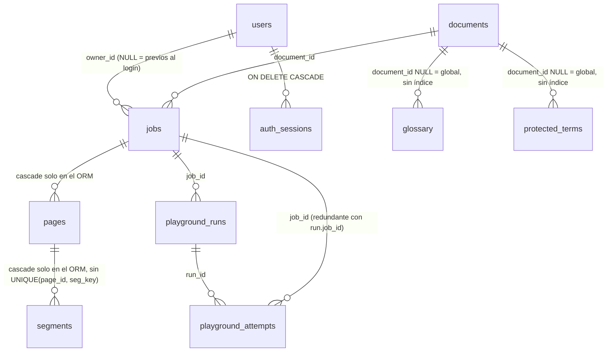

# Revisión del backend (noviembre 2026)

Revisión de `backend/` (FastAPI + SQLAlchemy + Alembic sobre SQLite, worker aparte) sin cambios de código, con la
guía `fastapi-db-review`. Cada problema tiene su ficha (`NN-slug.md`: qué pasa, cómo reproducirlo, impacto y
corrección propuesta) y su archivo de aceptación (`NN-slug.aceptacion.md`: casillas con resultados verificables).
Las casillas empiezan vacías (`- [ ]`) y se marcan (`- [x]`) con una línea «Verificado:» al comprobarlas.

No hay hallazgos críticos: autorización por propietario (IDOR), CSRF/Origin, inyección SQL, secretos y asignación
masiva se revisaron y están bien.

## Línea base (16 de noviembre de 2026)

- Versiones: FastAPI 0.163.1, Starlette 1.10, Pydantic 2.14.3, SQLAlchemy 2.1.9, Alembic 1.20.1, pytest 9.2.
- Modo síncrono (`get_db` con `yield`, `expire_on_commit=False`); el worker (`app/worker.py`) se coordina con la API
  por las tablas `jobs` y `playground_runs`. SQLite (WAL, `foreign_keys=ON`) en producción y en los tests.
- `cd backend && .venv/bin/python -m pytest -q -m "not slow and not s3"`: **138 passed, 1 skipped, 5 deselected** (34 s).
- ruff, mypy/pyright y `alembic check`: no instalados / no se ejecutan (#15).
- Migraciones: 10, lineales; cabeza `d2e4f6a8c0b1` = la de `data/app.db`.
- Datos (solo lectura): 1 libro, 192 páginas, 3345 bloques, 149 entradas de glosario, 2141 de caché, 4 usuarios,
  114 sesiones (113 revocadas). `PRAGMA foreign_key_check` vacío; sin duplicados en glosario, `(page_id, seg_key)`
  ni `sha256`.
- Queries por petición sobre una copia de la BD real (incluyen 3 de la sesión de auth):

| Endpoint | Queries |
|---|---|
| `GET /api/jobs` (1 trabajo) | 5 (+2 por trabajo) |
| `GET /api/jobs/1` | 5 (una trae las 192 páginas) |
| `GET /api/admin/jobs/1/summary` | **198** |
| `GET /api/admin/jobs/1/pages/10/segments` | 5 |
| `GET /api/jobs/1/pages` | 4 |
| `GET /api/admin/playground/books` | 5 |
| `GET /api/glossary?document_id=1` | 3 |

## Mapa de relaciones

`auth_security_events.user_id` no es FK a propósito (la bitácora sobrevive a la cuenta). `files`, `prompt_drafts`
y `translation_cache` no tienen relaciones. Diferencias modelo/esquema: el CHECK `ck_users_role` solo está en la BD
(#17); ninguna FK salvo `auth_sessions` tiene `ON DELETE` (#09).

## Problemas

| # | Severidad | Problema | Aceptación | Estado |
|---|---|---|---|---|
| 01 | Alto | [Una corrección manual se pierde si se guarda mientras el libro se procesa](01-edicion-perdida-durante-proceso.md) | [criterios](01-edicion-perdida-durante-proceso.aceptacion.md) | resuelto |
| 02 | Alto | [El worker puede sobrescribir una cancelación con «done», «paused» o «failed»](02-worker-pisa-cancelacion.md) | [criterios](02-worker-pisa-cancelacion.aceptacion.md) | resuelto |
| 03 | Medio | [Pedir otra recomposición mientras se recompone pierde la petición](03-recomposicion-pierde-paginas.md) | [criterios](03-recomposicion-pierde-paginas.aceptacion.md) | resuelto |
| 04 | Alto | [El estado de un trabajo carga todas sus páginas y el listado hace N+1](04-job-status-carga-paginas.md) | [criterios](04-job-status-carga-paginas.aceptacion.md) | resuelto |
| 05 | Alto | [El resumen del admin hace una consulta por página](05-summary-n-mas-1.md) | [criterios](05-summary-n-mas-1.aceptacion.md) | resuelto |
| 06 | Alto | [Las subidas directas bloquean el event loop](06-async-bloqueante-subidas.md) | [criterios](06-async-bloqueante-subidas.aceptacion.md) | resuelto |
| 07 | Bajo | [El flujo SSE de progreso hace consultas síncronas en el loop y no se usa](07-sse-sin-uso.md) | [criterios](07-sse-sin-uso.aceptacion.md) | resuelto |
| 08 | Medio | [Un usuario sin rol admin ve la pista de la llave de DeepSeek](08-settings-expone-pista-llave.md) | [criterios](08-settings-expone-pista-llave.aceptacion.md) | resuelto |
| 09 | Medio | [Las FK no definen qué pasa al borrar y el borrado de un libro carga todo en memoria](09-fks-sin-ondelete.md) | [criterios](09-fks-sin-ondelete.aceptacion.md) | resuelto |
| 10 | Medio | [Nada en la BD impide duplicados en bloques, glosario y términos](10-sin-unique-duplicados.md) | [criterios](10-sin-unique-duplicados.aceptacion.md) | resuelto |
| 11 | Medio | [Varios parámetros de entrada son texto libre](11-entradas-sin-validar.md) | [criterios](11-entradas-sin-validar.aceptacion.md) | resuelto |
| 12 | Medio | [PDFs y sesiones de base de datos que no se cierran](12-recursos-sin-cerrar.md) | [criterios](12-recursos-sin-cerrar.aceptacion.md) | resuelto |
| 13 | Medio | [Borrado duplicado, imports internos y consultas al estilo 1.x](13-logica-duplicada-y-legacy.md) | [criterios](13-logica-duplicada-y-legacy.aceptacion.md) | resuelto |
| 14 | Medio | [Ningún endpoint declara su esquema de respuesta](14-sin-response-model.md) | [criterios](14-sin-response-model.aceptacion.md) | resuelto |
| 15 | Medio | [Sin linter, sin chequeo de tipos y sin control de divergencia del esquema](15-sin-lint-ni-checks.md) | [criterios](15-sin-lint-ni-checks.aceptacion.md) | resuelto |
| 16 | Bajo | [Sesiones, intentos de login, eventos y caché crecen sin límite](16-tablas-crecen-sin-limite.md) | [criterios](16-tablas-crecen-sin-limite.aceptacion.md) | resuelto |
| 17 | Bajo | [El CHECK del rol existe en la BD pero no en el modelo](17-check-rol-solo-en-migracion.md) | [criterios](17-check-rol-solo-en-migracion.aceptacion.md) | resuelto |
| 18 | Bajo | [Variables reutilizadas y un diccionario de locks que crece sin límite](18-estilo-menor.md) | [criterios](18-estilo-menor.aceptacion.md) | resuelto |
| 19 | Bajo | [Avisos de ruff previos silenciados por archivo](19-avisos-ruff-pendientes.md) | [criterios](19-avisos-ruff-pendientes.aceptacion.md) | resuelto |
| 20 | Bajo | [Al borrar un libro, glosario, términos e intentos se borran fila a fila](20-borrado-glosario-fila-a-fila.md) | [criterios](20-borrado-glosario-fila-a-fila.aceptacion.md) | resuelto |

## Preguntas de negocio (se hacen antes de la ficha)

- #03: ¿rechazar (409) una recomposición mientras hay otra, o encolar las páginas?
- #07: ¿quitar el SSE sin uso o conservarlo arreglado?
- #08: ¿qué campos de Configuración ve el rol user? (propuesta: proveedor y modelo).
- #09: ¿CASCADE en la BD para páginas, bloques e intentos, y RESTRICT en documentos y usuarios?
- #16: retención de la bitácora de seguridad (propuesta: 180 días).
- Documentos: cada subida crea un `Document` nuevo aunque el `sha256` coincida; se mantiene así (sin ficha).

## Orden recomendado

1. #01, #02, #03: pérdida de datos y carreras entre la API y el worker.
2. #08: seguridad (cambia el contrato para el rol user).
3. #15: herramientas (ruff, `alembic check`, `count_queries`) antes de medir y refactorizar.
4. #04, #05, #06, #12: rendimiento y recursos.
5. #10, #09, #17: esquema, con migraciones y confirmación previa.
6. #11, #14, #13, #07, #16, #18: validación, contrato, estructura y mantenimiento.

## Comportamientos de regresión

- Login, cambio obligatorio de contraseña, reautenticación, logout y matriz de permisos (`tests/test_auth*.py`).
- `user`: subir un PDF (S3 prefirmado y respaldo), ver el progreso, cancelar, reanudar, descargar PDF/EPUB, ver
  solo sus libros.
- `admin`: resumen, bloques, corregir y recomponer una página, glosario y términos, borrar un libro,
  Configuración, Usuarios y Playground (estimar y ejecutar con prueba sin API).
- Worker: procesar, recomponer, preparar para el Playground y recuperar trabajos huérfanos tras reiniciar.

## Estado final (17 de noviembre de 2026)

Las 20 fichas están resueltas (columna Estado de la tabla de problemas: «resuelto» en las 20 filas).

### Queries por endpoint

Mismo método que la línea base (`baseline.py` con `admin_client`, contador sobre `before_cursor_execute`, copia de
`data/app.db` con la API de backup de sqlite3 en `mode=ro`; 1 libro, 192 páginas, 3345 bloques; copia en la cabeza
`f3b5d7e9a1c4`). En esta medición la sesión cuenta **2 queries** en los 7 endpoints (sesión y usuario, sin escritura
de `last_seen`), igual que en las mediciones de #04 y #05 en este equipo; el `3` del glosario en la línea base solo
cuadra con 2 de sesión, así que la comparación es entre cifras con la misma sesión.

| Endpoint | Antes | Después | Ficha |
|---|---|---|---|
| `GET /api/jobs` (1 trabajo) | 5 (+2 por trabajo) | **4** (no crece con los trabajos) | #04 |
| `GET /api/jobs/1` | 5 (trae las 192 páginas) | **5** (solo las páginas a revisar: 1 fila) | #04 |
| `GET /api/admin/jobs/1/summary` | **198** | **6** | #05 |
| `GET /api/admin/jobs/1/pages/10/segments` | 5 | 5 | — |
| `GET /api/jobs/1/pages` | 4 | 4 | — |
| `GET /api/admin/playground/books` | 5 | 5 | — |
| `GET /api/glossary?document_id=1` | 3 | 3 | — |

### Fichas y commits

| # | Commits |
|---|---|
| 01 | `6a5443c`, `83b7c35` |
| 02 | `f39a302`, `112bfb6`, `ab64a9d` |
| 03 | `30a919f`, `b49e1d1` |
| 04 | `03b5cbb`, `c1e2091` |
| 05 | `2ccecb7`, `07f1633` |
| 06 | `c0b3ea9`, `af87478` |
| 07 | `69ae2c7`, `ccd6fa9` |
| 08 | `1592a3c`, `d2d0f55` |
| 09 | `0b140d9`, `8222ad3` |
| 10 | `a27ede6`, `a3d1434` |
| 11 | `c35ac2d`, `c9fd561` |
| 12 | `5f7c410`, `9926271` |
| 13 | `12b75fa`, `26f2832`, `b419ce4` |
| 14 | `5ae85be`, `d53924e` |
| 15 | `a9c31ed`, `6a70c3c`, `d5f3bce` |
| 16 | `b90c42b`, `60ed868` |
| 17 | `36a622f`, `e30d768` |
| 18 | `408fdbf`, `ed897db` |
| 19 | `26b9542`, `8f0a64c`, `bd98fad` |
| 20 | `31a186b`, `f4e9fcb` |

### Migraciones nuevas (en orden)

De 10 a 12 migraciones, lineales; cabeza `f3b5d7e9a1c4` (`alembic heads`), la misma que la copia de `data/app.db`.

1. `e1f3a5c7b9d2` (#10, sobre `d2e4f6a8c0b1`): índices únicos `uq_segments_page_seg_key (page_id, seg_key)`,
   `uq_glossary_doc_source (coalesce(document_id, 0), lower(source))` y
   `uq_protected_terms_doc_term (coalesce(document_id, 0), term)`. Sin reconstruir tablas. Reversible: el downgrade
   borra los tres índices.
2. `f3b5d7e9a1c4` (#09, sobre `e1f3a5c7b9d2`): FK con `ON DELETE` explícito (CASCADE en páginas, bloques e intentos;
   RESTRICT en documentos, usuarios y trabajos del Playground) reconstruyendo las tablas con `batch_alter_table`, e
   índices de `document_id`. Reversible: upgrade → downgrade -1 → upgrade verificado sobre una copia con las mismas
   filas y contenido por tabla y `foreign_key_check` vacío.

### Comprobaciones

- `cd backend && .venv/bin/python -m pytest -q -m "not slow and not s3"`: **190 passed, 1 skipped, 5 deselected**
  (46 s; línea base 138 passed).
- `.venv/bin/ruff check app tests`: All checks passed!
- `test_alembic_check` (`tests/test_tooling.py`): 1 passed.
- App desplegada, sin cuentas: `GET :8000/api/health` → 200 `{"ok":true}`; `GET :3100/login` → 200; a través de
  :3100, `/api/jobs`, `/api/settings`, `/api/users` y `/api/admin/jobs/1/summary` → 401 `UNAUTHENTICATED`.
- `frontend/` (lo tocó #08): `npx tsc --noEmit` sin errores, `npm run lint` sin avisos, `npm run test` 20 passed
  (3 archivos), `npm run build` correcto y `node ../handoff/check.mjs app lib` 59 archivos, 0 problemas.

### Regresión con sesión en la app desplegada (18 de noviembre de 2026)

Con las cuentas QA `qa-admin@` y `qa-user@astrobooks.local` (autorizadas solo para esta pasada), Chrome (Playwright) contra
localhost:3100 y libros QA sin texto o con texto mínimo; **ninguna llamada a DeepSeek** (comprobado en el log del worker).
16 de las 18 casillas pendientes quedan en [x]:

- `user` (#02, #04, #06, #07, #18): login, solo sus libros (`/api/jobs/1` 404), subir un PDF de 120 páginas en blanco, ver el
  progreso por polling, cancelar (sigue `cancelled`), reanudar, descargar PDF y EPUB; `/api/jobs/<id>/events` 404.
- #08: rótulo «API · deepseek-flash» en la barra y el inicio como user, `/api/settings` sin `deepseek_key_hint`;
  Configuración del admin se ve completa (no se guardó).
- `admin`: Resumen con los totales del JSON (#05); vista previa original/traducida y recomponer una página (#12);
  Glosario y términos: añadir, editar, borrar, «Ese término ya existe.» (#10) y categoría inválida → 422 (#11);
  Playground: lista, alcance, estimar y evaluación con la variante sin API (#11); Usuarios: lista, cambio de rol ida y
  vuelta y desactivación (#17); login, sesión, logout y bitácora (#16); borrar libros QA desde Inicio y desde el
  Playground sin filas suyas en la BD (#09, #13, #20).

Las 2 restantes (**#01 y #03**, corregir un bloque en la UI y recomponer esa misma página) se cerraron después en una
pasada aparte, sin gastar: un libro QA de 1 página y 1 bloque traducido con el traductor falso dentro del contenedor `api`
(`worker.process` con `runtime_settings.load` parcheado solo en ese proceso); en la UI, corregir y guardar el bloque
(`edited: true`, persiste al recargar), «Recomponer página», guardar otra corrección durante la recomposición → 409 y
segunda recomposición → 409; al terminar, `done` sin `recompose_error`, el bloque conserva la corrección y la vista
Comparar y el PDF muestran el texto corregido. La recomposición la ejecutó `worker.process` con el traductor falso (worker
desplegado parado durante la prueba): con DeepSeek activo, `translate_segments` traduce también los bloques editados
antes de imponer la corrección y la caché va por modelo, así que habría llamado al modelo. Sin actividad del worker ni
filas nuevas `deepseek-flash` en la caché. Limpieza: libro QA borrado desde la API, fila `fake` de la caché borrada,
qa-admin desactivada y sin sesiones abiertas, credenciales borradas; el libro #1 sigue con 192 páginas y 3345 bloques.
**Ninguna casilla pendiente.**

Limpieza: libros QA #2, #3 y #4 borrados (con sus archivos); qa-user desactivada desde Usuarios y qa-admin con el servicio
de usuarios de la app dentro del contenedor `api` (no puede desactivarse a sí misma); sin sesiones QA abiertas;
credenciales borradas del scratchpad. El libro #1 sigue con 192 páginas y 3345 bloques (`data/app.db` en solo lectura).

**Contraseña obligatoria, reautenticación, preparar y huérfanos** (pasada aparte, sin gastar; cuentas QA reactivadas solo
para ella, Chrome con Playwright contra localhost:3100):

- **Cambio obligatorio de contraseña.** Tras `app.cli auth-recover --email qa-admin@…`, el login con la temporal lleva a
  /change-password («Elige tu contraseña»); `/`, `/admin/users`, `/admin/playground` y `/glossary` redirigen allí;
  `GET /api/jobs` y `/api/settings` → 403 `PASSWORD_CHANGE_REQUIRED`; `/api/auth/me` da sesión `restricted`. Al guardar
  la nueva en el formulario, la app va a `/`, `/api/jobs` → 200, sesión `normal`, y la temporal ya no entra (401).
  Lo mismo con qa-user tras «Contraseña temporal» en Usuarios (la fila muestra «Pendiente de cambiar la contraseña»).
- **Reautenticación.** qa-admin, recién entrada y sin confirmar: `PATCH /api/users/4` (nombre) y
  `POST /api/users/4/reset-password` → 409 `REAUTH_REQUIRED`; en Usuarios, «Activar» qa-user → `PATCH` 409 y diálogo
  «Confirma tu contraseña» (sigue «Desactivada»); al confirmar, `POST /api/auth/reauthenticate` 200, se repite el
  `PATCH` (200) y queda «Activa»; el reset inmediato ya no pide confirmar (200, temporal mostrada).
- **Preparar para el Playground.** «Subir un libro nuevo» con un PDF en blanco de 2 páginas → «Libro listo para
  evaluar» en 2 s («Sin traducir · no se ha gastado saldo»); trabajo `done`, `options {"mode": "prepare"}`, 2 páginas y
  0 bloques. Log del worker: «Glosario: 0 candidatos … 0 términos»: con 0 candidatos `discover_glossary` vuelve antes de
  `extract_glossary`, así que no llama al modelo.
- **Huérfanos.** Con un segundo libro QA preparado igual (#3) y sin otros trabajos activos (`app.cli active-jobs` solo
  listaba el #3; libro #1 `done`, 0 evaluaciones en cola), se puso solo esa fila en `running` desde el contenedor `api`
  y se hizo `docker compose restart worker`: «Worker iniciado» y luego «Procesando trabajo 3» (`claim_job` solo toma
  trabajos `queued`, así que `recover_orphans` lo devolvió a la cola), «preparado: 2 páginas, 0 bloques» y `done`
  sin error.
- **Cero llamadas al modelo.** En `docker compose logs worker api` desde el inicio de la pasada, 0 líneas con `httpx`,
  `HTTP Request`, `deepseek` o `chat/completions`; la caché sigue con 2141 filas `deepseek-flash` y ninguna `fake`.

Limpieza: libros QA #2 y #3 borrados desde el Playground (`GET /api/jobs/2` y `/3` → 404); qa-user desactivada por la
API y qa-admin con el servicio de usuarios dentro del contenedor `api`, sin sesiones abiertas; credenciales borradas
del scratchpad. Solo queda el libro #1 (192 páginas, 3345 bloques; `data/app.db` en solo lectura), sin páginas ni
bloques huérfanos, y los 5 contenedores siguen arriba.
